# CarStalker

<p align="center">
  
</p>

**Your car, decoded.** A free OBD-II app for Android that goes beyond a live dashboard — assisted diagnostics that use live data and the ECU's own self-tests to rank likely causes, show the evidence and say what it cannot prove.

No accounts. No ads. No subscriptions. No in-app purchases. A 1.9 MB download.

## Not just another OBD-II dashboard

There are plenty of apps that show RPM and clear codes. CarStalker starts there and adds the part that is usually missing: **assisted diagnostics**.

- Every guide declares the signals it needs, the stages it captures, the safety stops and its limitations.
- A capability resolver checks the car's supported PIDs and engine profile before offering a test. Missing signals produce an explicit *Limited test* or *Vehicle unsupported* state instead of a useless result.
- The result lists observations, candidate causes with evidence for and against, competing explanations, a confidence category (not a fabricated probability) and one next check.
- Tests stop for a flashing MIL, misfire codes, overheating or voltage limits.

The app is deliberately honest about uncertainty: a P0420 plus a matching downstream trace is supporting evidence, not a parts order.

### Small by design

The release APK is **1.9 MB**. A fresh install takes about **5 MB**, and Android's background code optimization can grow the installed app to roughly **12 MB** — the APK is the download, not the on-device footprint. Drive recordings add about **1 MB per hour** and are kept until you delete them. Comparable OBD apps routinely ship at tens or hundreds of megabytes because of ads, analytics, crash SDKs, bundled media and cross-platform runtimes. CarStalker has none of those: Kotlin, Jetpack Compose and a pure Kotlin protocol engine, no image assets beyond the icon, no telemetry.

Small also means fast to install, light on storage, and usable on an old phone left in the glovebox.

### Standing on public work

CarStalker does not invent a new diagnostic science. It compiles and curates **publicly available, freely licensed information** into one complete, offline tool:

- generic OBD-II behaviour from SAE J1979 / ISO 15031-5 and ISO 15765-2;
- the CC0 generic DTC catalogue from OBDex (9,500+ SAE J2012 codes);
- public technical explanations and independent technician guidance for the guided rules, with thresholds and wording written for this project;
- public VIN/WMI prefixes for vehicle labels.

Where something is a heuristic, the app says so. Where a source is licensed, [THIRD_PARTY_NOTICES.md](THIRD_PARTY_NOTICES.md) names it. No OEM service publication, paid database or proprietary app text is copied.

## Release status

CarStalker is open source under the MIT license. It is currently in **beta**: the APK is distributed from GitHub Releases first, and a Google Play beta will follow once the app has been exercised on more vehicles and adapters.

The source, the diagnostic rules and the evidence are in this repository. The app is not on Google Play yet.

Release notes are in [CHANGELOG.md](CHANGELOG.md). The 2026-11-24 independent review findings and their fixes are recorded in the internal review notes, which are kept outside the published repository.

Store copy, beta notes and the Play Console answers live in [docs/store-listing.md](docs/store-listing.md). The privacy policy is in [docs/privacy-policy.md](docs/privacy-policy.md) and is also available inside the app under **Settings → About → Privacy policy**.

## Download

The beta is distributed as a signed APK from [GitHub Releases](https://github.com/clifarr/carstalker/releases). The app is not on Google Play yet.

- [Releases](https://github.com/clifarr/carstalker/releases)
- Verify the SHA-256 checksum published with each release.
- Android 8.0+ (API 26). No account or adapter is needed to try demo mode.
- For automatic updates, add the repository to [Obtainium](https://github.com/I?mranR98/Obtainium). An IzzyOnDroid listing may follow.
- See [docs/install.md](docs/install.md) for sideloading, Play Protect and update instructions.

## Privacy

CarStalker does not collect, transmit, sell or share personal data. Settings, vehicle identity, recordings and reports stay in the app's private storage until you choose to share them. There are no accounts, ads, analytics or telemetry. See [docs/privacy-policy.md](docs/privacy-policy.md) for the full policy.

---

## Screens

| Guided diagnostics | Guided test in progress |
| --- | --- |
| 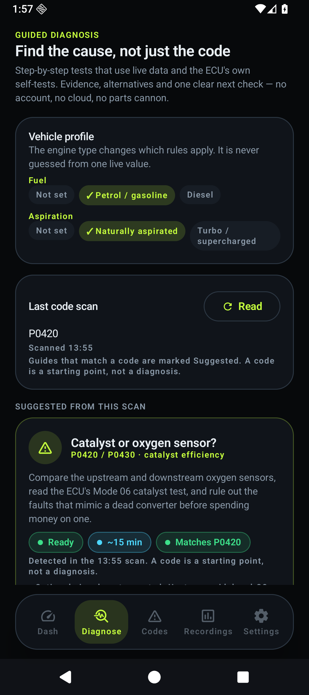 | 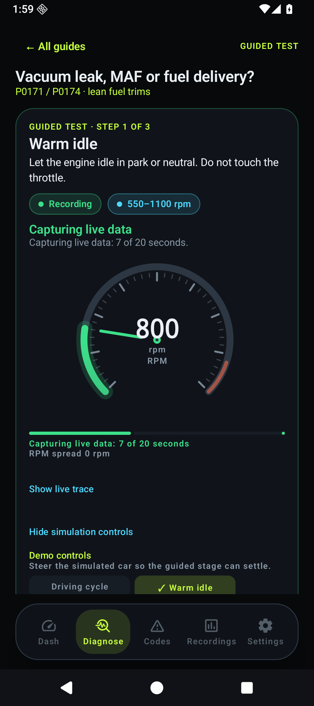 |

| Assisted result with evidence | Trouble codes |
| --- | --- |
| 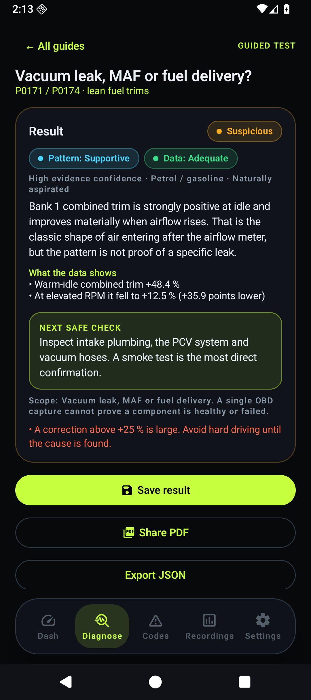 | 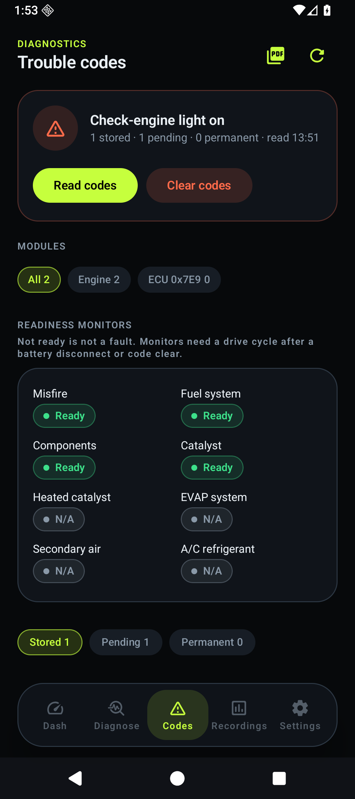 |

| Connect | Dashboard |
| --- | --- |
| 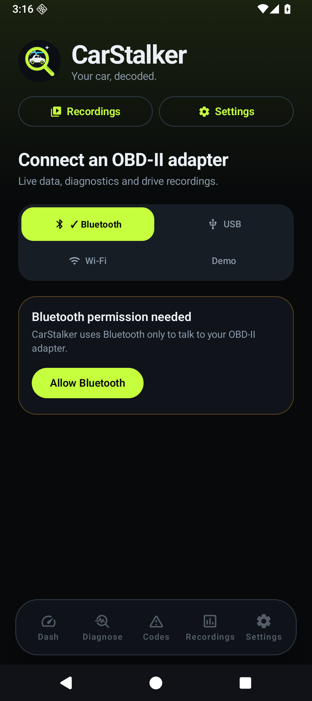 | 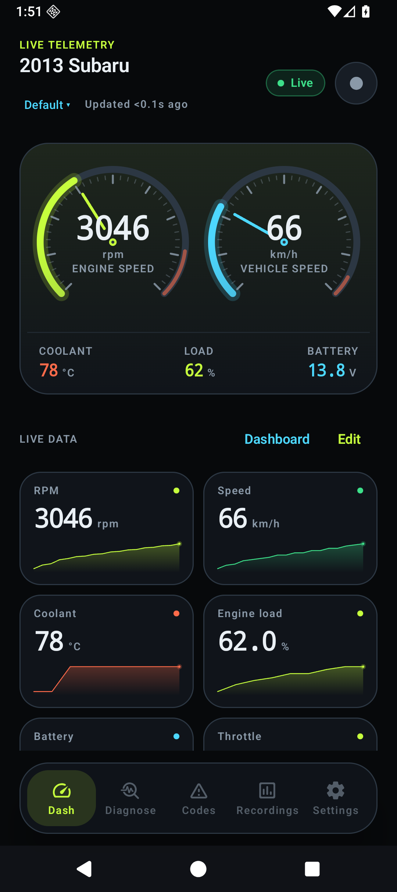 |

| Recordings | Playback |
| --- | --- |
| 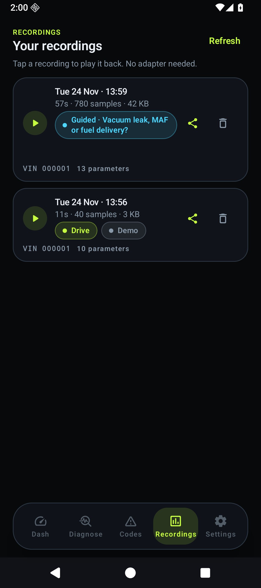 | 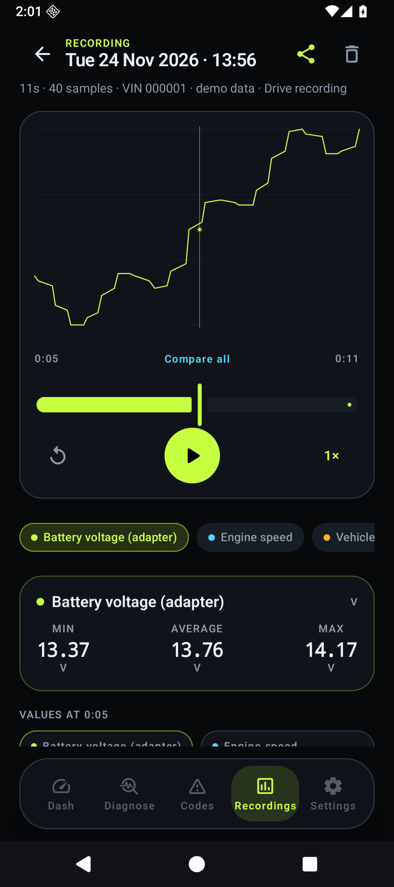 |

| Custom PID editor | Settings |
| --- | --- |
| 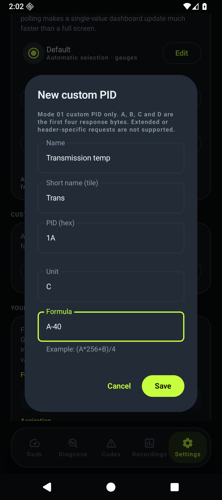 | 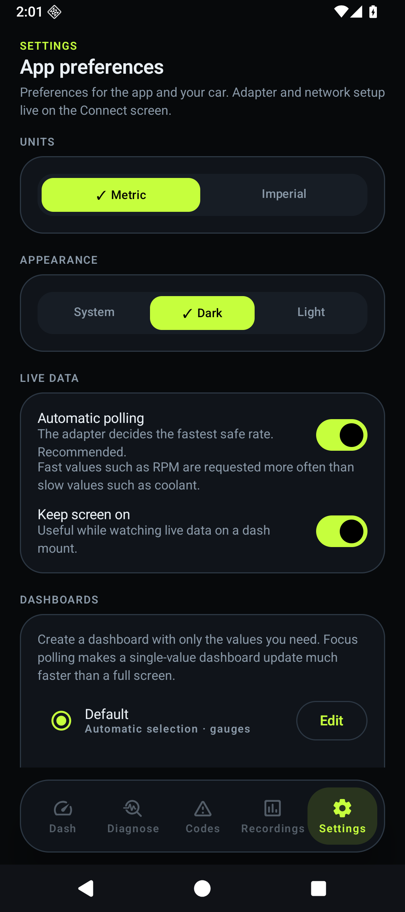 |

| Dashboards | Single-value voltage dashboard |
| --- | --- |
| 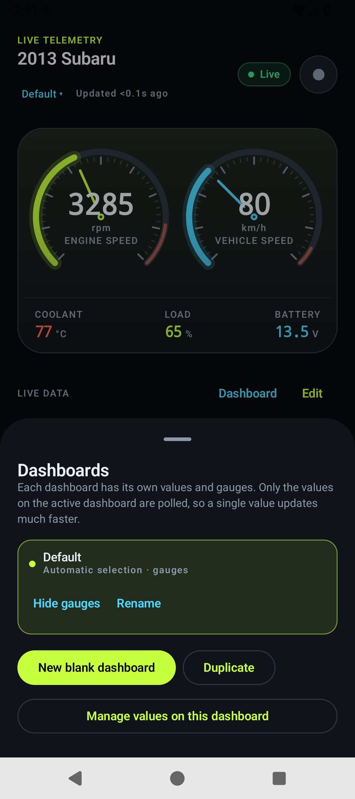 | 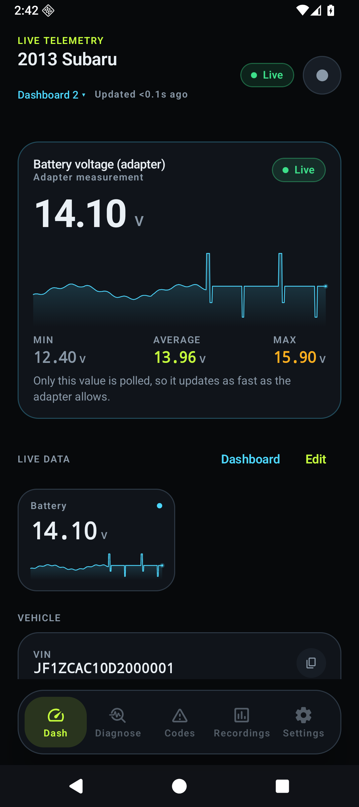 |

The guided screenshots are from **demo mode**: a simulated 2013 BRZ with a lean-trim scenario. No hardware, account or cloud service is involved.

## What it does

- **Guided diagnostics platform** — reusable, vehicle-aware tests with a capability resolver, settling/capture state machine, per-stage sampling, evidence-backed findings and an exportable result. 21 guides are registered; all are startable in at least a documented limited mode.
- **Deterministic, not a chatbot** — every rule is in the repository and runs offline. No AI service, no account, no cloud, no hallucinated parts list.
- **Safety rails** — tests stop for a flashing MIL, misfire codes, overheating or voltage limits; the catalyst wizard refuses to condemn a converter when engine health or an exhaust leak could explain the code, and it warns against O2 spacers or converter deletes.
- **Live telemetry** — canvas gauges for RPM and speed, plus sparkline tiles for load, coolant, intake temperature, MAF, throttle, fuel trims, fuel level and more. A tile whose parameter stops producing samples is marked `stale` instead of pretending the value is live. The default dashboard picks six of the most useful parameters the connected car actually reports (up to ten can be shown), and the parameter picker groups everything by category (engine, drivetrain, fuel, temperature, electrical, emissions).
- **Dashboard editing** — press and hold a card for one second to pick it up. It follows your finger, the cards around the drop slot move aside, and a vertical line marks where it will land. Drop it on another card to move it, or release it in place to choose a replacement from the values not already on the dashboard; values the car does not report stay visible as N/A. The gauge top is a magnetic scroll point, so the dashboard resists leaving it and settles back with the gauges on top.
- **Multiple dashboards** — create a blank dashboard with only the values you need and hide the gauge card. Only the values on the active dashboard are polled, so a single value such as adapter voltage updates as fast as the adapter allows. Each dashboard keeps its own parameters and gauge visibility.
- **Battery voltage from the adapter** — read with `ATRV` every cycle and shown as its own parameter (`Battery`, no OBD PID), so it works on cars whose ECU does not report PID 42. Real PID 42 (`Control module voltage`) is still available in the parameter picker but is not picked automatically.
- **Diagnostics** — read stored, pending and permanent trouble codes with human-readable descriptions, clear codes behind a confirmation, and see MIL status.
- **Per-ECU code scan** — when the adapter exposes CAN headers, responses are attributed to the ECU that sent them (engine and any other module that answers generic OBD requests) instead of silently keeping only the first reply.
- **Freeze frames** — Mode 02 snapshots the sensor values recorded when a code was stored, so you can see load, temperature, fuel trims, speed and RPM at the moment of failure.
- **Mode 06 self-tests** — read on-board monitor test results (catalyst, O2, EVAP, misfire) with the ECU's own minimum and maximum limits, pass/fail state and margin to the nearest limit.
- **DTC knowledge** — the bundled CC0 generic database covers 9,500+ SAE J2012 codes, and common codes include clean-room likely causes and next checks.
- **PDF reports** — preview a shop-branded diagnostic report in-app with pinch-to-zoom, then share or print it. The report carries the CarStalker mark in the header, VIN, modules, codes, freeze frames, readiness monitors and Mode 06 results.
- **Adapter health** — while connected, the Connect screen shows the adapter identifier, protocol and description, warns about the common "ELM327 v1.5" clone, and measures round-trip requests per second.
- **Readiness monitors** — misfire, fuel system, catalyst, EVAP and friends, with Ready / Not ready / N/A states for emissions checks.
- **Vehicle identity** — VIN, calibration ID, CVN and ECU name via OBD mode 09, plus a heuristic model year and manufacturer from the public VIN/WMI prefixes.
- **Drive recordings** — every sample is recorded to wide-format CSV (one row per tick, one column per parameter) with a metadata preamble, then share or analyse it anywhere. Legacy long-format recordings still play back.
- **Offline playback** — open any recording without an adapter, scrub the timeline, pinch the chart to zoom and pan, and inspect every parameter on a live chart.
- **Custom PIDs** — define manufacturer-specific parameters with a formula (`A`, `B`, `C`, `D` are the response bytes), unit, range and decimals.
- **Demo mode** — a simulated 2013 BRZ, so you can explore the whole app without hardware. It also simulates ELM327 request latency, so dashboard cycle times and guided capture sample rates look realistic instead of impossibly fast.

## Guided diagnostics

The guided platform answers a practical question: **which cause is most plausible, what else could explain it, and which check would distinguish them?** Each guide declares its required signals, stages, settling rules, safety stops and limitations. A capability resolver checks the car's supported PIDs and engine profile before offering a Start action; missing signals produce an explicit `Limited test` or `Vehicle unsupported` state instead of a useless test.

The engine is a pure Kotlin state machine (`waiting → settling → capturing`, with pause, safety-stop and disconnect paths). It samples only the active stage's PIDs, timestamps every sample, computes effective rates and gaps, and discards mixed samples when conditions are lost. The result lists observations, candidate causes with evidence for/against, competing explanations, a confidence category (not a fabricated probability) and one next check. Results can be saved to the existing recordings store or included in the PDF report.

The [screenshots above](#screens) are a real run of the lean-mixture guide in demo mode: the simulated car reports +48 % combined fuel trim at warm idle that falls to +12 % at 2,500 rpm. CarStalker reports *"Consistent with unmetered air"* as **supportive, not conclusive**, lists five other explanations, and recommends a smoke test — it does not order a part.

See [docs/guided-diagnostics.md](docs/guided-diagnostics.md) for the architecture and for adding a definition and its interpreter.

### Guided workflow catalogue

| Phase | Guide | What it does |
|---|---|---|
| **1** | **Catalyst vs oxygen sensor** | Compares upstream/downstream O2, reads Mode 06, and rules out engine and exhaust faults before blaming the converter. |
| **1** | **Lean mixture** | Compares combined STFT/LTFT at warm idle and steady RPM, keeps banks separate, and ranks unmetered air, airflow measurement and fuel delivery without proving one. |
| **1** | **Thermostat vs ECT sensor** | Records a cold start, checks the warm-up time and plateau, and separates an early-opening thermostat from a sensor/wiring problem. |
| **1** | **Charging and electrical health** | Compares key-on, idle, moderate RPM and loaded voltage; treats smart charging and adapter-voltage limits explicitly. |
| **1** | **MAP plausibility** | Compares key-on MAP with BARO, checks idle vacuum on naturally aspirated petrol engines, and looks at throttle response. |
| **2** | **Rich-running mixture** | Compares negative trims at idle and elevated RPM, checks O2 feedback and ranks purge, injector, airflow and pressure causes. |
| **2** | **Oxygen sensor responsiveness** | Applies narrowband or wideband rules by sensor type, checks response to a gentle throttle change and refuses a verdict when sampling is too slow or a heater code is present. |
| **2** | **Misfire investigation** | Uses the ECU's misfire codes, RPM stability, load, trims and voltage; does not invent cylinder-specific Mode 06 counts. |
| **2** | **MAF plausibility** | Checks whether MAF is alive and scales with RPM/MAP/load without universal grams-per-second thresholds. |
| **2** | **Cranks but does not start** | Captures cranking RPM, voltage and MAP, and reports missing data explicitly instead of blaming a crank sensor. |
| **3** | **Turbo under/overboost** | Limited measured-boost trend: engine-off MAP/BARO plausibility plus throttle response; never claims requested-versus-actual boost without a target PID. |
| **3** | **Fuel pressure** | Checks measured low-pressure or rail-pressure stability and response; requested-versus-actual needs a supported target channel. |
| **3** | **EGR flow and control** | Correlates commanded EGR/error with MAP/MAF response and treats disagreement as a flow/control investigation. |
| **3** | **Throttle and pedal** | Correlates throttle, redundant throttle, pedal and commanded-throttle channels during a stationary response. |
| **3** | **EVAP purge** | Correlates purge command with fuel-trim response; cannot locate a leak or prove a valve failed. |
| **3** | **DPF health** | Passive standard-PID 0x7A/0x7B differential pressure and 0x7C temperature check; no forced regeneration or soot-load claim. |
| **4** | **Fuel consumption** | Captures a fuelling snapshot from fuel rate or MAF; needs a stored baseline before it can judge a change. |
| **4** | **Intermittent power loss** | Passenger-marked passive drive capture; compares the marked event with the preceding seconds and ranks ignition, fuel, boost, electrical and mechanical possibilities. |
| **4** | **Emissions readiness** | Summarises readiness monitors, stored/pending/permanent codes, counters and Mode 06 failures. |
| **4** | **Used-car inspection** | Passive codes/readiness/counters/trims/charging summary with explicit “not an inspection” limits. |
| **4** | **Longitudinal health baseline** | Saves a same-vehicle, same-condition baseline in settings and compares later captures only when the conditions match. |

All registered workflows are now startable in at least a documented limited mode; none remain as “Planned”.

### Catalyst vs oxygen sensor

The catalyst guide answers a common and expensive question: **is the catalytic converter actually worn, or is an oxygen sensor, exhaust leak or engine fault mimicking it?**

It follows the same evidence a good technician uses:

1. **Prepare** — warm the engine, read codes, read the ECU's Mode 06 catalyst test, and confirm there is no flashing MIL, misfire, fuel-trim fault, oil loss or coolant loss.
2. **Capture** — record upstream and downstream O2, RPM and coolant at a steady ~2,500 rpm (or 50–60 km/h). The app pauses normal polling so the O2 channels get the best rate the adapter can provide.
3. **Observe** — answer a few things the app cannot measure: exhaust hiss/soot, recent exhaust work, oil/coolant loss, whether the downstream sensor responded to a throttle snap, and optional IR temperatures.
4. **Decide** — a deterministic rule set ranks the causes, shows the evidence (Mode 06 pass/fail, switching rates, correlation, capture quality) and gives next steps with a confidence level.

The result is deliberately conservative: a P0420 plus a matching downstream trace is supporting evidence, not a parts order. The wizard says so, and it refuses to condemn the converter when engine health or an exhaust leak could explain the code.

It is not an AI chatbot. There is no account, no cloud call and no generated parts list. The rules are in the repository and the evidence is shown to the user.

Current limits:

- Generic OBD-II only; no manufacturer-specific catalyst monitor or service data.
- Vehicle identity is best-effort: not every car answers Mode 09 PID 02/04, so the VIN or calibration ID may be unavailable. The dashboard shows what the ECU reported, labels a car without a VIN as **Vehicle** or **Unidentified vehicle**, and says that the VIN was not reported. Some UK/European models, including certain Honda Civics, only expose the VIN through manufacturer-specific diagnostics.
- Some cars do not report downstream PID 15 or do not support Mode 06. The wizard says so and lowers its confidence instead of guessing.
- The live comparison uses the narrowband O2 PIDs 14/15. Wideband/equivalence-ratio cars are detected and the guide marks the live comparison unavailable, leaning on Mode 06 instead.
- ELM327 sample rate is limited; Mode 06 is preferred when available, and the live O2 trace is supporting evidence.
- The rule thresholds are a starting point and need real-car validation. Treat the result as guidance, not a repair order.

The Phase 1 lean-mixture, thermostat, charging and MAP guides use the shared engine. Their thresholds are configurable examples, and every result states what it cannot prove.

## Adapters

| Connection | Notes |
|---|---|
| **Bluetooth Classic** | ELM327 dongles using RFCOMM/SPP (`00001101-…`). This is what most cheap "OBDII" dongles are. Pair the dongle in Android settings, then pick it in the app — paired adapters are listed instantly, no scan needed. |
| **Bluetooth LE** | ELM327 BLE adapters. Prefers the FFE0/FFE1 serial service and falls back to the first writable/notifiable characteristic. |
| **USB** | ELM327 USB cables via OTG. FTDI, CH340, CP210x, PL2303 and CDC-ACM chipsets (through [usb-serial-for-android](https://github.com/mik3y/usb-serial-for-android)). Serial speed (baud rate) is chosen in the USB pane. |
| **Wi-Fi** | ELM327 Wi-Fi adapters over TCP, default port 35000. Host and port are edited in the Wi-Fi pane. |

Bluetooth lists only compatible adapters: devices advertising a known serial service, or whose names match a known dongle family. There is no "show all devices" option, so you can't accidentally pick your neighbour's car.

> **"My dongle is paired but the app can't see it."** Almost always a Classic/SPP dongle. Open the Bluetooth tab, select **Bluetooth Classic**, and it will appear under **Paired**. Bluetooth LE and Classic are separate radio modes, so a Classic dongle never shows up in an LE scan.

The response window is 400 ms (`ATST 64`). Bluetooth Classic alone costs 100-200 ms per exchange on many clones, so a tighter window makes every read fail intermittently.

The handshake resets the adapter, turns off echo and linefeeds, detects the protocol with a real `0100` exchange, then **pins** it (`ATSP<n>`) so reconnects skip the search. CAN buses also get auto formatting, flow control, headers on (so responses can be attributed to an ECU) and (for 29-bit) `ATAR`; ISO/J1850 buses keep headers off and get a longer response window. Responses are parsed from plain, header-prefixed and ELM `n:` multi-frame formats, including 29-bit CAN headers printed as four separate bytes (`18 DA F1 10 04 41 0C 0C 84`) and ISO-TP first/consecutive frame reassembly for multi-frame answers such as VIN.

Latency is handled at three levels: stale bytes are discarded before every write, only parameters the ECU advertises are requested, and the [poll scheduler](core/src/main/kotlin/com/carstalker/core/obd/PollScheduler.kt) asks for fast-changing values more often than slow ones. Parameters that stop answering are dropped for the session.

An ELM327 stays powered and answers `ATRV` after the ignition is switched off, so adapter voltage is never treated as proof that the vehicle is alive. After 2.5 s without an ECU answer the dashboard marks the vehicle offline, dims the gauges and hides the last readings; polling continues in the background and live values return automatically when the ECU answers again.

Bluetooth discovery is always manual: tap **Scan**, pick an adapter from the list, then confirm the connection. Nothing connects in the background. Paired Classic adapters are listed without scanning.

## Build

Requirements: JDK 17+, Android SDK platform 36. The project uses AGP 8.10.1 and Gradle 8.11.1.

```bash
git clone https://github.com/clifarr/carstalker.git carstalker
cd carstalker
echo "sdk.dir=$ANDROID_HOME" > local.properties   # or set ANDROID_HOME
./gradlew :app:assembleDebug
```

The debug APK lands in `app/build/outputs/apk/debug/`. Install with:

```bash
adb install -r app/build/outputs/apk/debug/app-debug.apk
```

Release builds are minified with R8. For Google Play, build an Android App Bundle:

```bash
./gradlew :app:bundleRelease
```

The AAB lands in `app/build/outputs/bundle/release/`. It is signed when `keystore.properties` is present, otherwise it is unsigned. To sign release builds, create a git-ignored `keystore.properties` in the project root:

```properties
storeFile=/absolute/path/to/release.jks
storePassword=...
keyAlias=...
keyPassword=...
```

Without that file, `assembleRelease` and `bundleRelease` produce unsigned artifacts.

## Tests

The protocol engine is a pure Kotlin module with no Android dependencies. App-side unit tests cover settings, playback, the report builder and custom PIDs:

```bash
./gradlew :core:test :app:testDebugUnitTest
./gradlew :app:lintRelease
```

Covered: ELM327 response parsing (headers, multi-frame, noise, multiple ECUs), ECU source attribution, PID decoding, supported-PID bitmaps, DTC decoding, the CC0 generic DTC catalogue, freeze frames, Mode 06 UAS scaling and limits, readiness monitors, VIN extraction, model-year derivation, the custom-PID formula parser, wide-format recording, the report model, signal analysis, the catalyst-wizard decision rules, the guided-test capability resolver, the settling/capture/disconnect state machine, and the Phase 1 lean-mixture, thermostat, charging and MAP interpreters using synthetic traces.

There is also an end-to-end UI smoke test:

```bash
./gradlew :app:connectedDebugAndroidTest
```

It drives the demo flow (connect, live data, diagnostics, clearing codes, recording, settings). Some OEM ROMs, including HyperOS/MIUI, block simulated input from ADB unless **USB debugging (Security settings)** is enabled in Developer options.

### Debug launch extras

Debug builds accept intent extras for screenshots and manual QA:

```bash
adb shell am start -n com.carstalker.app/.MainActivity \
  --es route dashboard --ez demo true --es action theme_dark
```

- `route`: `connect`, `dashboard`, `codes`, `logs`, `settings`
- `action`: `clear_codes`, `record`, `export_pdf`, `guided_lean_demo`, `theme_light`, `theme_dark`

These are ignored in release builds.

## Releasing

See [docs/release.md](docs/release.md) for the signed APK release process and the GitHub Actions secrets, and [docs/store-listing.md](docs/store-listing.md) for the Play listing copy.

## Project layout

```
core/   Pure Kotlin OBD-II engine
  transport/   Transport abstraction
  elm/         ELM327 client, response parser, protocol names
  obd/         PIDs, decoders, readiness, units, formula parser, freeze frames, Mode 06
  dtc/         DTC decoding, CC0 generic catalogue, clean-room guidance
  vehicle/     VIN / calibration / CVN decoding
  log/         Wide-format CSV schema
  report/      Shared diagnostic report model
  diagnose/    Guided-wizard models, signal analysis and catalyst rules
  guided/      Diagnostic registry, capability resolver, stage runner, analyzers

app/    Android + Jetpack Compose UI
  data/        DataStore settings, CSV recording repository, PDF report renderer
  service/     Connection lifecycle, polling loop, catalyst and guided capture
  transport/   BLE, USB serial, TCP and demo transports
  ui/          Theme, components, screens (DiagnoseScreen, GuidedTestScreen, CatalystFlow)
```

## Design notes

- **Dark-first instrument cluster.** Carbon surfaces, a lime "volt" accent and cyan secondary, with a light theme for daylight. Gauges and sparklines are drawn with Compose Canvas; the brand mark is the same vector drawable used by the launcher icon.
- **Polling is serialized by design.** An ELM327 is one serial link with a single request/response exchange at a time; parallel commands would desynchronise replies. Every command goes through a mutex, and any bytes left from a previous exchange are discarded before the next write.
- **Values are polled by priority.** Adapter voltage, RPM, speed and throttle every cycle; load/coolant/relative throttle/pedal/intake/MAF/fuel every other cycle; everything else every fourth. Voltage is polled every cycle so cranking dips are captured, and throttle is polled fast because a pedal movement is over before a slow Bluetooth cycle returns. While a parameter's detail view is open it is requested every cycle, and a voltage-only dashboard uses adapter freshness rather than a leftover ECU timestamp. A tile that stops receiving samples is marked `stale` after 10 s, and the detail view shows that parameter's own sample age, so a value the ECU keeps reporting at one position is not confused with a poll that stopped working.
- **Throttle PIDs are manufacturer-flavoured.** PIDs `0x11` (throttle position) and `0x45` (relative throttle) are the throttle body/plate on many cars, not pedal travel. Some ECUs hold them at a fixed position while the pedal moves and only change them during idle-stop or engine-state transitions. Compare with **Accelerator pedal D/E** (`0x49`/`0x4A`) before treating a static value as a sensor fault.
- **Adapter liveness is not vehicle liveness.** The ELM327 keeps answering `ATRV` with the ignition off. A [freshness monitor](core/src/main/kotlin/com/carstalker/core/obd/LiveDataFreshness.kt) waits for a failed ECU request, then hides the last engine values and reports the vehicle as offline; it recovers as soon as a PID answers again.
- **Metric is canonical.** Values are decoded in metric and converted for display; CSV recordings always keep metric units.
- **Wide format, not long format.** Recordings write one row per sample tick with one column per channel, so a spreadsheet or MoTeC i2 can read them without a pivot. Missing samples are blank rather than silently stale.
- **One report model.** The PDF renderer and plain-text share path both consume the same `DiagnosticReport`, so a report cannot disagree with itself.
- **Only redistributable data.** Generic DTCs are CC0; protocol facts are implemented from public standards. No OEM database or paid service text is bundled.
- **Data stays on device.** Settings live in DataStore, recordings in app-private storage, shared only when you choose to share them.
- **Guided tests are definitions, not screens.** A registry declares signals, stages, safety rules and limitations; a pure runner enforces settling and capture; an analyzer produces observations and competing explanations. The UI only renders the state and the evidence.
- **A capture is reusable.** Guided samples keep per-PID timestamps and can be saved to the same wide-format recording store as a normal drive log.

## Data and licenses

CarStalker does not claim to invent a new diagnostic method. It compiles and curates publicly available, freely licensed information into one tool, and ships only data that can be redistributed:

- **Generic DTC descriptions** — the 9,500+ SAE J2012 generic codes come from [OBDex](https://github.com/foerbsnavi/obdex), dedicated to the public domain under **CC0 1.0**. See [THIRD_PARTY_NOTICES.md](THIRD_PARTY_NOTICES.md).
- **Protocol behaviour** — implemented from public standards and observed adapter behaviour (SAE J1979, ISO 15765-2, ISO 14229 service identifiers). No paid standard text or proprietary database is copied.
- **No OEM databases** — manufacturer-specific DIDs, service functions and coding data are not bundled. Enhanced diagnostics will use clean-room, community-reviewed vehicle packs, with provenance recorded for every entry.
- **Guided diagnostics** — the procedures are informed by public technical explanations and independent technician guidance (APEX Tech Nation, TroubleCodes.net, AA1Car, EngineerFix). The rules, thresholds and wording are CarStalker's own; no service-publication text is copied. Treat the thresholds as a starting point that still needs real-car validation. The guide definitions and analyzers live in [`core/guided`](core/src/main/kotlin/com/carstalker/core/guided).
- **No telemetry** — recordings and reports stay in app-private storage until you choose to share them.

If you contribute vehicle data, only submit values you measured yourself or material you have the right to redistribute. Do not paste text from VCDS, FORScan, Car Scanner, BimmerCode, AlfaOBD, JScan or any paid service publication.

## Scope and safety

CarStalker speaks generic OBD-II (SAE J1979). It can show every ECU that answers generic OBD requests, but it does not yet read manufacturer-specific modules or perform service functions. Those need clean-room vehicle packs and are the next step.

Manufacturer-specific modules and enhanced PIDs require custom definitions and vary by vehicle. Clearing codes resets readiness monitors — don't do it right before an emissions test, and don't use it to hide a fault you haven't fixed. This is a diagnostic aid, not a replacement for service information or a professional inspection.

## License

MIT — see [LICENSE](LICENSE).

Built with Kotlin, Jetpack Compose, AndroidX, kotlinx.serialization and [usb-serial-for-android](https://github.com/mik3y/usb-serial-for-android) (Apache-2.0).
